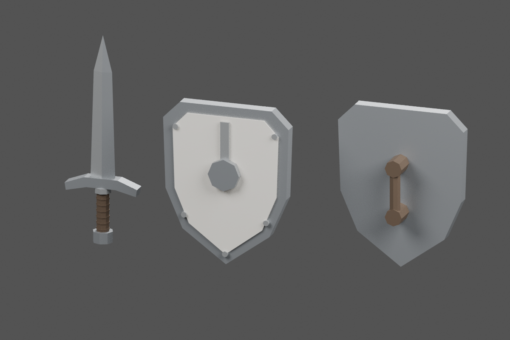

# Tripo Fighter: modular equipment preparation

Production-only work, 30 October 2026. The selected character is the steel-armored
Tripo Elf Fighter, Studio asset `1447de15-fb60-4516-a6db-1384f4a9e5a7`.
The original character archives are unchanged. No character was replaced and no
game integration, merge or deployment was performed.

## Source inspection: the Fighter export is missing

The complete tree of `docs/elf-character-production` at
`d9b7aef6605be647b81b8610666717ccf1bb7209` contains 1,702 files under
`output/characters/elf-fighter-v1`: 1,690 JPGs, one PNG, five MP4s, five frame
lists and one text file. It contains **no mesh, rig or texture-atlas export**.
Searching the fetched Git history for FBX, GLB, glTF, OBJ, BLEND and ZIP files
also found no Fighter source. The ZIP contents were inspected as well.

The available FBX files and ZIP packages are the unarmored v1/v2 bases. The v2
rig and its reported 65 bones belong to a different asset and cannot establish
the Fighter's rig quality. See [source-audit.json](source-audit.json) for the
inventory, source hashes and archive contents. Studio itself was not accessed;
no Studio retrieval capability was available in this session.

The [Studio result](../elf-fighter-v1/studio-fighter-result.jpg) establishes the
intended visual direction: muted steel armor, brown leather and ivory cloth.
Its UI reports 6,262 faces / 6,089 vertices. Those numbers are **not an independent
mesh audit**, nor a verified post-rig triangle count. The PNG is a reference
image, not a UV texture. Neither was substituted for a model.

## Delivered equipment

These are newly authored, separate low-poly props intended to complement that
direction. They are not extracted Tripo geometry or the blue/brass body prototype.

| File | Exact mesh/node | Triangles | Bytes | Materials / primitives |
|---|---|---:|---:|---:|
| [sword.glb](sword.glb) | `Weapon_Main` | 322 | 18,084 | 3 |
| [shield.glb](shield.glb) | `Shield` | 332 | 19,168 | 4 |

Both files are glTF 2.0 binary, in metres, Y-up, with identity object transforms.
They have one mesh each, no cameras/lights, external references, skeletons or
animations. They use flat PBR materials without texture images. The shield's
near-white `Accent` panel is independently recolorable; steel and leather retain
their colors. The other materials are `Steel`, `Steel_Edge`, and `Leather`.

- Sword: 0.8505 m long, 0.30 m across the guard, blade along local +Y.
- Shield: 0.52 m wide, 0.65 m high, front toward local +Z. The rear grip has
  48 mm clearance between its surface and the backing at the center.
- Each origin is the center of the hand grip, not the floor. Negative Y bounds
  are intentional for an attachment asset. The final assembled character must
  still have its feet at Y=0.
- Attach `Weapon_Main` to the actual right-hand bone and `Shield` to the actual
  left-hand bone after importing the Fighter. Bone names, rest-pose offsets,
  proportions and finger closure are unknown; no hand fit is claimed.

The props total **654 triangles and 37,252 bytes**. They leave 19,346 triangles
of the 20,000-triangle character limit for the body, but the combined character
budget cannot be certified until the actual Fighter is exported. The 4 MB file,
100-joint and 8-skinned-mesh character limits remain unverified. Seven material
primitives across the two props are a potential batching cost; consolidate when
assembling if runtime measurements warrant it.



This image is a Blender render of the **re-imported GLBs**. The repeated shield
is a second preview instance rotated to expose the rear grip, not a third asset.
The render was visually checked for silhouette, material separation, blade and
guard shape, and rear grip. The shield backing was moved forward to provide
finger clearance. No equipped-character or in-game visual test was possible.

## Rig and motion assessment

The archived Fighter samples reviewed were `walk/frame-00000.jpg`, `00069`,
`00136`, `00213`, and `slash/frame-00136.jpg` under `animation-tests/`.
The walk shows alternating legs and attached limbs, but the apparent character
size/position changes against a fixed viewport. This is consistent with forward
root motion; it is not a numeric root-motion measurement. The slash sample is
unarmed. Screenshots cannot verify joint count/names, skin weights, animation
curves, loop continuity, foot sliding or ground penetration.

**No Fighter walk was edited.** Editing the unarmored v2 rig or inventing a new
body would not fix this selected Fighter. No claim is made that `Idle`, `Walk`,
`Attack_Melee`, `Hit`, `Death`, `Use_Item` or `Dodge` exist in an exported Fighter.

To unblock the next pass, export this exact Studio asset as FBX or GLB with its
skin, skeleton, base-color texture and idle/walk/slash clips. Include the bind
pose and preserve the original export. Supply the Tripo plan/terms evidence
before runtime distribution; the archive still lacks resolved Tripo licensing.

Once that source exists:

1. Audit actual topology, weights, `Head`, bones, scale, facing and clip ranges.
2. Work on a copy. Measure world-space horizontal root/hips displacement over
   a complete walk cycle. Remove the accumulated forward travel while preserving
   vertical bob and cyclical sway; do not blindly freeze every hip channel.
3. Bake at 30 fps, close the cycle without a duplicate-frame pause, and verify
   no horizontal drift at the loop boundary. Tune feet using a visible floor
   and known travel speed; an in-place clip alone cannot certify no sliding.
4. Fit these props, test idle/walk/attack grips and armor/shield intersections,
   and keep the weapons below the head in the rest pose used for bounds.
5. Export the assembled GLB and check all character requirements, including
   missing clips, license evidence and the final 20k/4 MB budgets, before Part B
   integration or replacing any fallback.

## Reproduction and verification

Blender 4.3.2 and Python 3 were used. No applicable Blender or software-engineering
skill package was available in the cloud or local skill catalogs; repository
`AGENTS.md`, `ROADMAP.md`, `PRD.md` and `CHARACTERS.md` were followed.

```sh
blender --background --threads 4 --python scripts/characters/generate-fighter-equipment.py -- --render
python scripts/characters/verify-fighter-equipment.py
```

The generator is the editable source; no large `.blend`, ZIP or frame sequence
is needed. Blender exporter changes may produce different file hashes; review
the outputs and update the inventory after intentional regeneration.

The verifier checks GLB structure, names, identity transforms, lack of external
dependencies/helpers/rigs, finite geometry, non-degenerate triangles, prop
budgets, grip bounds, `Accent`, and every inventory hash.

Khronos `gltf-validator` was also run on both exports: **zero errors, warnings,
infos or hints**. [validation.json](validation.json) records the version and
per-file findings. Optional reproduction after installing `gltf-validator`
outside the repository:

```js
const report = await validator.validateBytes(new Uint8Array(glbBytes), {uri: filename});
console.log(report.issues);
```

Repository regression checks: **487 tests passed**, all three typechecks passed,
and `npm run build` passed including the existing runtime asset gate. That gate
validates the currently bundled game assets, not these production-only props.
New props were verified separately as described above. No runtime source files
or dependency manifests changed.

The original geometry authored here is CC0-1.0; see [LICENSE.txt](LICENSE.txt).
This dedication does **not** cover or relicense the earlier Tripo assets.
The inventory in [manifest.json](manifest.json) records deliverable hashes and
provenance, and is not a runtime character acceptance manifest.
